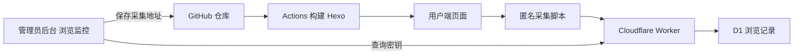

# 浏览监控部署

博客仍由 Hexo 构建、GitHub Pages 托管。后台内容管理继续调用 GitHub Contents API，浏览记录由独立的 Cloudflare Worker 接收并保存到 D1。

## 部署步骤

在项目根目录执行（需要登录有 Workers 和 D1 权限的 Cloudflare 账号）：

1. `npx wrangler login`
2. `npx wrangler d1 create chenblog-analytics`
3. 将返回的数据库 ID 填入 `analytics/wrangler.toml` 的 `database_id`。
4. 将 `ALLOWED_ORIGINS` 改为实际博客的 origin（协议 + 域名，不带末尾斜线）；多个 origin 用英文逗号分隔。后台和用户端的域名都应在此列表中。
5. `npx wrangler d1 execute chenblog-analytics --remote --file analytics/schema.sql --config analytics/wrangler.toml`
6. `npx wrangler secret put ADMIN_TOKEN --config analytics/wrangler.toml`，设置至少 32 位随机密钥。它不是 GitHub Token，不要写进 site.json 或仓库。
7. `npx wrangler deploy --config analytics/wrangler.toml`
8. 打开后台「浏览监控」，填写返回的 Worker HTTPS 地址和查询密钥，勾选启用，保存采集设置。此操作通过已有 GitHub Token 提交 `source/_data/site.json`，Actions 发布后生效。
9. 打开用户端页面，等待 30 秒，在监控页刷新。初次采集才开始生成数据；无法恢复启用前的访问历史。

本地验证可添加 `http://localhost:4000` 到 ALLOWED_ORIGINS，并执行 `npx wrangler d1 execute chenblog-analytics --local --file analytics/schema.sql --config analytics/wrangler.toml` 和 `npx wrangler dev --config analytics/wrangler.toml`。本地开发密钥存入 `analytics/.dev.vars`，不要提交。

## 本地独立验收

Node 22.13+ 或 Node 24+ 下，先 `npm ci`、`npm run build`，再运行 `node analytics/local-dev.mjs`。打开 `http://localhost:4000/` 浏览文章，再访问 `http://localhost:4000/admin/#/analytics`，输入测试密钥 `local-test-only` 并刷新。它直接执行同一 Worker 处理器，使用内存 SQLite；停止进程后测试数据消失，线上配置不会被修改。端口 4000、8787 需空闲。接口回归：`node --test analytics/worker.test.mjs`。

## 统计口径和边界

- PV：每次加载用户端页面一条记录，30 秒心跳更新原记录，不增加 PV。后台不采集。
- UV：按浏览器 sessionStorage 中的随机会话 ID 去重；浏览器关闭、存储不可用、多设备会影响结果，并非注册用户人数。
- 活跃访客：最近 90 秒发送过数据的匿名会话；后台刷新时重新计算。
- 时间范围：北京时间自然日，包含今天；最近记录最多 50 条，热门页面及来源最多 20 条。
- 停留：仅计页面可见时间，30 秒一次上报，切后台或离开时补报。浏览器强制退出、网络失败、拦截器和禁用 JS 会导致少记，未收到最终上报时使用最后一次收到的数据。
- 页面只采集 pathname 和页面标题，来源只保存域名；不采集查询参数、表单、姓名、学号、班级、IP 或完整 User-Agent；遵循 Do Not Track。
- 每天定时删除超过 90 天的记录。公开采集接口做来源和字段校验、重复记录去重；Origin 并非防伪认证，数据不能用于计费或审计。高流量站点应在 Cloudflare 增加速率限制并检查当前套餐配额。
- 查询接口须同时满足允许的 Origin 和 ADMIN_TOKEN；密钥仅存在后台页面内存中，刷新页面需重新输入。采集脚本不包含密钥。

## 项目入口

| 模块 | 文件 | 作用 |
|---|---|---|
| 博客构建 | `_config.yml`、`scripts/` | 生成文章、搜索索引、订阅、站点地图 |
| 用户端 | `themes/chen/layout/`、`themes/chen/source/js/` | 阅读、分类、搜索、作业下载 |
| 内容后台 | `source/admin/admin.js` | GitHub 内容读写、Markdown 编辑、站点和作业管理 |
| 内容数据 | `source/_posts/`、`source/_data/` | Markdown 文章、站点配置、作业清单 |
| 监控采集 | `themes/chen/source/js/analytics.js` | 生成匿名会话、发送访问及停留 |
| 监控服务 | `analytics/worker.mjs`、`schema.sql` | 入库、统计、鉴权、过期清理 |
| 发布 | `.github/workflows/deploy.yml` | 自动构建及发布 GitHub Pages |

Cloudflare 官方配置参考：[D1 入门](https://developers.cloudflare.com/d1/get-started/)、[Worker 查询 API 与密钥](https://developers.cloudflare.com/d1/tutorials/build-an-api-to-access-d1/)。
